# EduPlatform: как всё устроено

Документ для тех, кто впервые открывает проект. Сначала общая картина, потом роли, данные и все основные процессы: кто что делает, какие эндпоинты вызываются и что происходит внутри.

> Схемы написаны на [Mermaid](https://mermaid.js.org/), GitHub отображает их прямо в браузере. В VS Code нужно расширение *Markdown Preview Mermaid Support*.

## Содержание

1. [Что это за система](#1-что-это-за-система)
2. [Архитектура и сервисы](#2-архитектура-и-сервисы)
3. [Структура репозитория](#3-структура-репозитория)
4. [Организации (мультиарендность)](#4-организации-мультиарендность)
5. [Роли и права](#5-роли-и-права)
6. [Модель данных](#6-модель-данных)
7. [Аутентификация и сессии](#7-аутентификация-и-сессии)
8. [Ключевые процессы](#8-ключевые-процессы)
9. [Уведомления и фоновые задачи](#9-уведомления-и-фоновые-задачи)
10. [Как устроен бэкенд](#10-как-устроен-бэкенд)
11. [Как устроен фронтенд](#11-как-устроен-фронтенд)
12. [Карта API](#12-карта-api)
13. [Безопасность](#13-безопасность)
14. [Запуск, демо-данные, тесты](#14-запуск-демо-данные-тесты)
15. [Что пока не сделано](#15-что-пока-не-сделано)

---

## 1. Что это за система

EduPlatform — платформа для школ и учебных центров. Одна установка обслуживает несколько организаций (школ), и данные каждой изолированы от остальных.

Что умеет платформа:
- **Курсы** трёх типов: школьный предмет, подготовка к экзамену, кружок. Внутри курса: разделы, уроки, видео с YouTube, материалы, комментарии.
- **Тесты** из банка вопросов: 6 типов вопросов, таймер, автопроверка, античит, ручная проверка развёрнутых ответов.
- **Домашние задания** со сдачей текстом, файлом или ссылкой, оценкой и пересдачей.
- **Расписание** групп и посещаемость.
- **Прогресс** для ученика, родителя, учителя и сводка для администратора.
- **Оплата курсов**: бесплатные, ручное подтверждение, Stripe.
- **Уведомления** в приложении и на почту, объявления.

**Стек:**

| Часть | Технологии |
|---|---|
| Бэкенд | Python 3.12, Django 5, Django REST Framework, SimpleJWT, drf-spectacular (Swagger) |
| База и очереди | PostgreSQL 16, Redis 7, Celery (worker + beat) |
| Фронтенд | Vue 3 (Composition API), Vite, TypeScript, Pinia, Vue Router, axios, KaTeX |
| Локальная среда | Docker Compose, MailHog (почта) |

---

## 2. Архитектура и сервисы

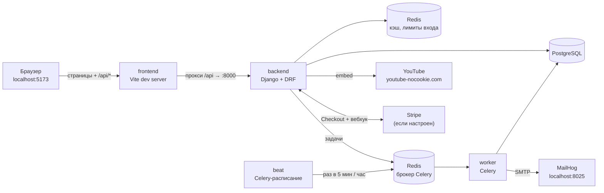

Все сервисы описаны в [`docker-compose.yml`](../docker-compose.yml):

| Сервис | Что делает | Порт |
|---|---|---|
| `db` | PostgreSQL, основная база | 5432 |
| `redis` | кэш, счётчики попыток входа, лимиты запросов, брокер Celery | 6379 |
| `backend` | REST API, Swagger, Django admin. При старте применяет миграции | 8000 |
| `worker` | Celery: отправка писем, фоновые задачи | — |
| `beat` | Celery Beat: по расписанию запускает напоминания | — |
| `frontend` | Vite dev server с HMR, проксирует `/api` на бэкенд | 5173 |
| `mailhog` | ловит все письма, веб-интерфейс для просмотра | 8025 |

**Почему фронтенд обращается к API через прокси.** Браузер видит один адрес (`localhost:5173`). Поэтому не нужен CORS, а cookie с refresh-токеном, которую Django ставит на путь `/api/v1/auth/`, работает без дополнительной настройки. В продакшене ту же роль выполняет nginx ([`frontend/docker/nginx.conf`](../frontend/docker/nginx.conf)).

---

## 3. Структура репозитория

```text
backend-bagdar.academy/
├── edu_platform/
│   ├── backend/                 Django-проект
│   │   ├── config/              settings (base/dev/test/prod), urls, celery
│   │   ├── apps/                доменные приложения (см. таблицу ниже)
│   │   ├── tests/               pytest
│   │   ├── seed_data.py         демо-данные
│   │   └── Dockerfile           стадии dev / prod
│   ├── frontend/                Vue-приложение
│   │   ├── src/api/             запросы к API по доменам
│   │   ├── src/stores/          Pinia: auth, toast, notifications
│   │   ├── src/views/           страницы
│   │   ├── src/components/      UI и составные компоненты
│   │   └── CLAUDE.md            правила для разработки фронтенда с Claude Code
│   ├── docs/ARCHITECTURE.md     этот документ
│   ├── docker-compose.yml
│   └── Makefile
├── archive/                     старые проекты, в работе не участвуют
└── .github/workflows/ci.yml     CI: линтер, миграции, тесты, сборка фронтенда
```

**Приложения бэкенда** (`backend/apps/`):

| Приложение | Отвечает за | Главные файлы |
|---|---|---|
| `common` | общие механизмы: организация запроса, JWT, права, базовые ViewSet, файлы, формат ошибок | `tenancy.py`, `authentication.py`, `viewsets.py`, `org_viewsets.py`, `files.py` |
| `accounts` | пользователи, вход, сессии, 2FA, сброс пароля, связь «родитель — ученик» | `services.py` (AuthService, TwoFactorService, ParentService) |
| `organizations` | школы, участники и роли, приглашения | `views.py` |
| `courses` | курсы, группы, записи учеников, **правила доступа** | `access.py` ← отсюда берут права все остальные |
| `content` | разделы, уроки, материалы, комментарии | `views.py` |
| `videos` | YouTube-видео, выдача плеера, прогресс просмотра | `services.py` (VideoService) |
| `questions` | темы и банк вопросов организации | `serializers.py` (проверка вариантов ответов) |
| `assessments` | тесты, попытки, автопроверка, статистика | `services.py` (AssessmentService, TestBuilderService) |
| `assignments` | домашние задания и их сдачи | `services.py` (AssignmentService) |
| `schedule` | группы, занятия, посещаемость | `services.py` (ScheduleService) |
| `progress` | прогресс по урокам и курсам, отчёты | `services.py` (ProgressService) |
| `notifications` | уведомления, объявления, письма | `services.py` (NotificationService), `tasks.py` |
| `payments` | заказы, провайдеры оплаты, вебхуки | `services.py` (PaymentService), `providers.py` |
| `audit` | журнал важных действий | `services.py` (AuditService) |

Зависимости между приложениями:

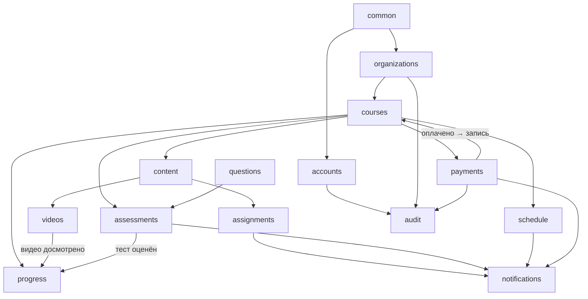

---

## 4. Организации (мультиарендность)

Каждый пользователь состоит в одной или нескольких организациях через `OrgMembership(org, user, role)`, и у него может быть несколько ролей в одной школе. **Все права проверяются в рамках текущей организации запроса**: роль «учитель» в школе А ничего не даёт в школе Б.

Как определяется текущая организация (`request.org_id`):

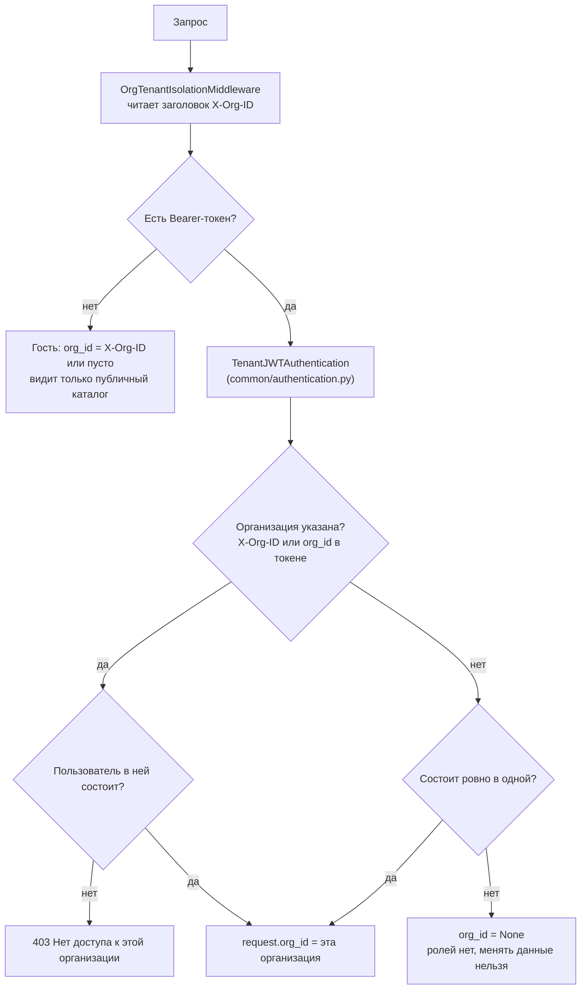

Что из этого следует:
- Фронтенд хранит выбранную школу в `localStorage.org_id` и добавляет к каждому запросу `X-Org-ID`. Переключатель в шапке меняет школу и заново загружает роли.
- Объекты другой организации не попадают в выборку, поэтому при обращении к ним приходит **404**, а не 403. Так нельзя даже узнать, существует ли объект.
- Банк вопросов, темы, участники и журнал аудита требуют выбранной организации. Без неё ответ **400**.

---

## 5. Роли и права

| Роль | Кто это | Как появляется |
|---|---|---|
| `student` | ученик | публичная регистрация, приглашение, добавление админом |
| `parent` | родитель | публичная регистрация, приглашение |
| `teacher` | учитель | приглашение или добавление админом |
| `curator` | куратор (наблюдает за успеваемостью) | приглашение или добавление админом |
| `admin` | администратор школы | назначает другой админ (или Django admin) |

Права на курсы вычисляются в одном месте, [`apps/courses/access.py`](../backend/apps/courses/access.py):

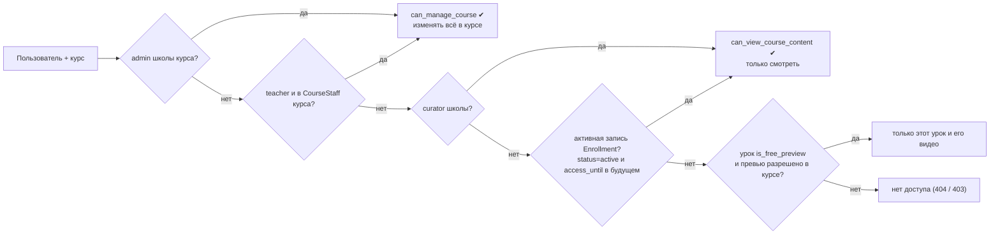

Важно: учитель, создавший курс, автоматически попадает в `CourseStaff`. Учитель, которого нет в `CourseStaff`, курс **видит**, но **менять его не может**.

**Матрица «роль × действие»:**

| Действие | Гость | Ученик | Родитель | Учитель | Куратор | Админ |
|---|:-:|:-:|:-:|:-:|:-:|:-:|
| Каталог опубликованных курсов | ✔ | ✔ | ✔ | ✔ (+черновики) | ✔ (+черновики) | ✔ (+черновики) |
| Записаться / купить курс | — | ✔ | ✔ | — | — | — |
| Смотреть уроки, видео, материалы | превью | при записи | — | свои курсы | ✔ | ✔ |
| Проходить тесты, сдавать задания | — | при записи | — | — | — | — |
| Создавать курс | — | — | — | ✔ | — | ✔ |
| Менять содержимое курса | — | — | — | если в CourseStaff | — | ✔ |
| Банк вопросов | — | — | — | ✔ | смотреть | ✔ |
| Проверять задания и открытые ответы | — | — | — | свои курсы | — | ✔ |
| Посещаемость | — | своя | детей | отмечать | смотреть | отмечать |
| Прогресс | — | свой | детей* | свои курсы | школы | школы |
| Объявления | — | читать | читать | для своего курса | читать | для школы и курсов |
| Участники и роли | — | — | — | смотреть | смотреть | менять |
| Приглашения | — | — | — | учеников на курс | — | любые роли |
| Подтвердить оплату, возврат | — | — | — | — | — | ✔ |
| Журнал аудита, сводка школы | — | — | — | — | — | ✔ |

\* только после того, как ребёнок подтвердил связь.

На фронтенде эти же правила отражены в `meta.roles` маршрутов ([`router/index.ts`](../frontend/src/router/index.ts)) и в пунктах меню ([`layouts/navigation.ts`](../frontend/src/layouts/navigation.ts)). Это только удобство интерфейса: **последнее слово всегда за бэкендом**.

---

## 6. Модель данных

Основные таблицы и связи (без технических полей):

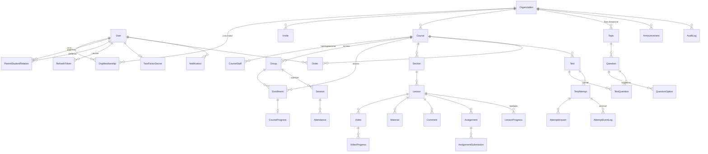

Соглашения:
- `TimeStampedModel` добавляет `created_at` и `updated_at` ко всем моделям.
- `SoftDeletableModel` (User, Organization, Course, Lesson): `delete()` только ставит `deleted_at`, а `objects` скрывает удалённые записи. Запись по-прежнему доступна через `all_objects`.
- Файлы (`Material.file`, `AssignmentSubmission.file`) сохраняются в `backend/media/` под случайными именами и **никогда не отдаются напрямую**, только через эндпоинт `.../download/` с проверкой прав.

---

## 7. Аутентификация и сессии

Используются два токена:
- **Access-токен.** JWT от SimpleJWT, живёт 15 минут, передаётся в заголовке `Authorization: Bearer …`. Содержит `sub` (id пользователя), `org_id`, `roles` и хеш пароля. После смены пароля все старые токены сразу перестают работать.
- **Refresh-токен.** Случайная строка, живёт 30 дней. В базе (`RefreshToken`) хранится только её SHA-256. Клиенту она приходит в ответе и в HttpOnly-cookie на путь `/api/v1/auth/`.

### Вход

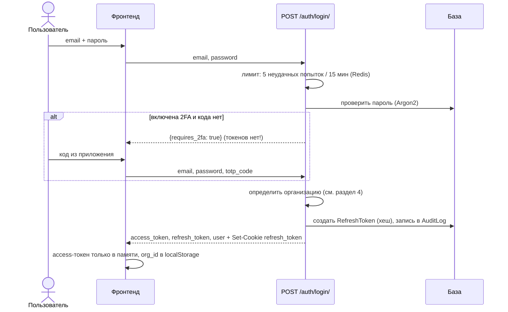

### Обновление и защита от кражи токена

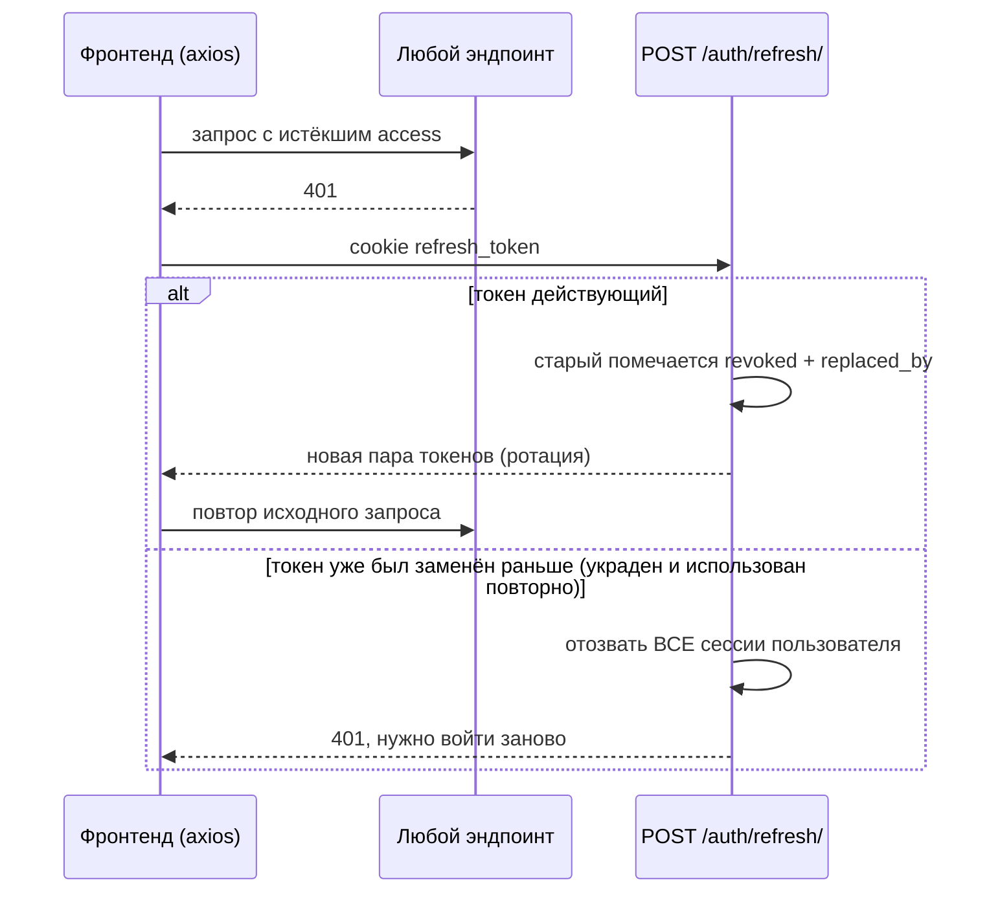

Все 401 в один момент времени обслуживает **один** общий запрос `/auth/refresh/` (`refreshPromise` в [`api/http.ts`](../frontend/src/api/http.ts)). При загрузке страницы фронтенд вызывает `auth.restore()`: через refresh-cookie восстанавливает сессию, а потом загружает профиль и список школ.

**Прочие процессы аккаунта:**

| Процесс | Эндпоинты | Особенности |
|---|---|---|
| Регистрация | `POST /auth/register/` | только `student`/`parent`, письмо со ссылкой `/verify-email?token=` |
| По приглашению | `POST /auth/register-by-invite/` | роль и курс задаёт приглашение, email сразу считается подтверждённым |
| Сброс пароля | `POST /auth/password-reset/` → `/confirm/` | ответ одинаковый для любого email; токен одноразовый, живёт 1 час; после сброса все сессии отзываются |
| 2FA | `/auth/2fa/setup/` → `/enable/` → `/disable/` | секрет зашифрован (Fernet), 8 одноразовых резервных кодов |
| Сессии | `GET /auth/sessions/`, `DELETE /auth/sessions/{id}/`, `/logout-all/` | список устройств, текущая сессия отмечена |

---

## 8. Ключевые процессы

### 8.1. Как ученик попадает на курс

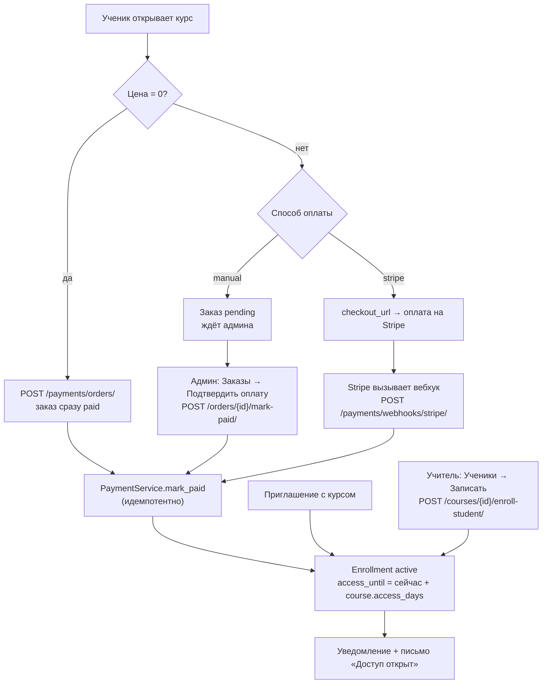

- Заголовок `Idempotency-Key` защищает от двойного заказа при повторном нажатии.
- Повторный вебхук или повторное подтверждение ничего не ломают.
- Возврат (`/refund/`) переводит заказ в `refunded`, а запись на курс в `canceled`.

### 8.2. Урок, видео и прогресс

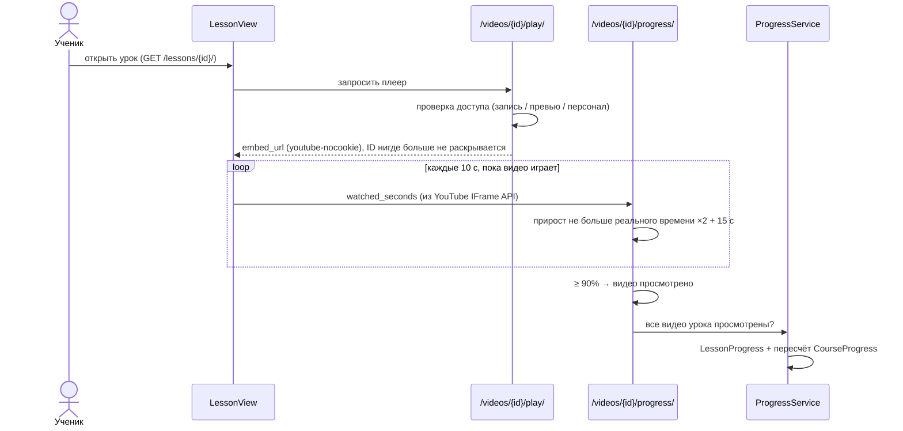

Урок можно отметить пройденным и вручную (`POST /lessons/{id}/complete/`), например если в нём нет видео. **Прогресс курса** считается так: пройденные опубликованные уроки / все опубликованные уроки. Дополнительно сохраняется средний из лучших результатов по каждому тесту.

### 8.3. Тест: от конструктора до оценки

Учитель создаёт вопросы в банке (`/questions/`), собирает тест (`/tests/`, `/tests/{id}/questions/`) и смотрит статистику (`/tests/{id}/stats/`).

Жизненный цикл попытки:

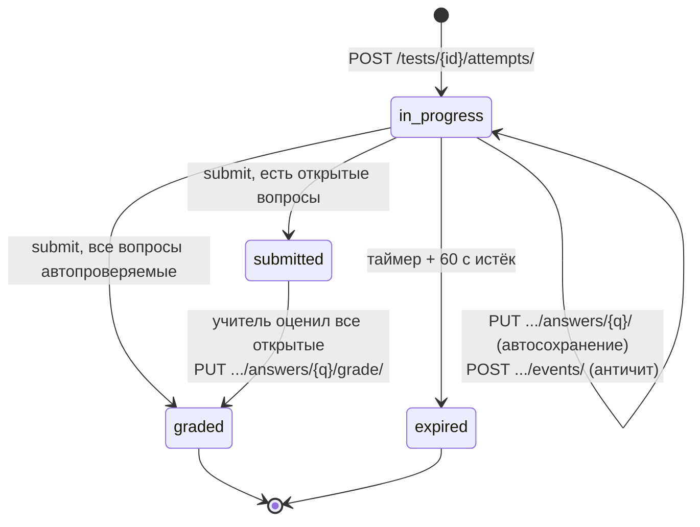

Правила, которые соблюдает сервер:
- **Ответы не утекают.** До сдачи клиент не получает `is_correct`, разборы и тексты правильных ответов. Для вопросов `short`/`number` варианты не отдаются вовсе, для `match` цели сопоставления идут отдельным перемешанным списком.
- **Порядок фиксируется.** Порядок вопросов и вариантов сохраняется в попытке, поэтому при продолжении он не меняется.
- **Таймер на сервере.** После дедлайна (+60 с на сетевую задержку) ответы не принимаются, а попытка закрывается со статусом `expired`.
- **Только свои вопросы.** Сохранить ответ на вопрос из другого теста нельзя (404), выбрать вариант из чужого вопроса тоже (400).
- **Лимит попыток.** `max_attempts` учитывает все завершённые попытки. Пока попытка не завершена, повторный старт продолжает её.
- **Состав теста блокируется.** После первой сданной попытки менять вопросы нельзя, иначе результаты станут несопоставимы.
- **Проверка по типам:** `single`/`multi` по точному совпадению набора вариантов, `number` с погрешностью `tolerance`, `short` без учёта регистра, `match` по всем парам, `open` вручную учителем.
- **Последствия.** После оценки ученик получает уведомление `test_result`, а прогресс курса пересчитывается.

### 8.4. Домашнее задание

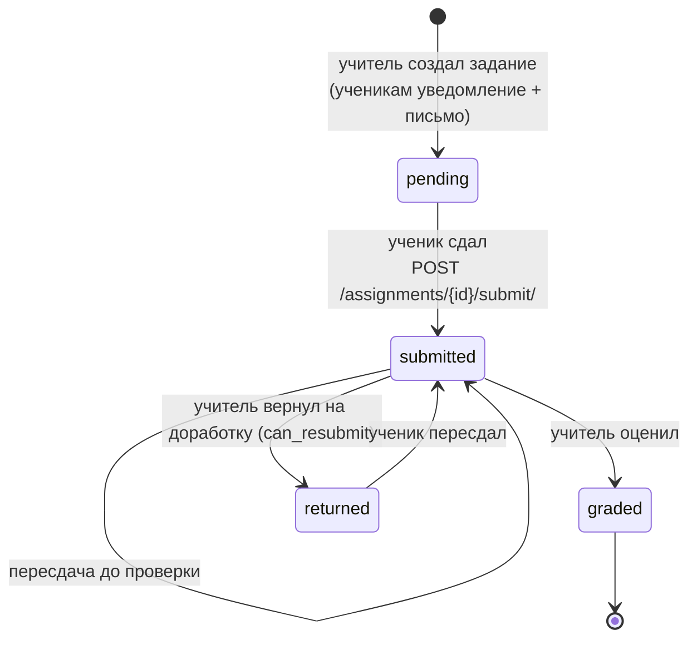

- После дедлайна работа принимается с пометкой `is_late`. Если у задания `accept_late = false`, она не принимается вовсе.
- Каждый час `beat` рассылает напоминание тем, кто не сдал задание с дедлайном в ближайшие 24 часа. Каждому ученику по каждому заданию оно уходит один раз.
- Сдачи видят ученик (свои), родитель (детей) и преподаватели курса (`GET /submissions/`).

### 8.5. Расписание и посещаемость

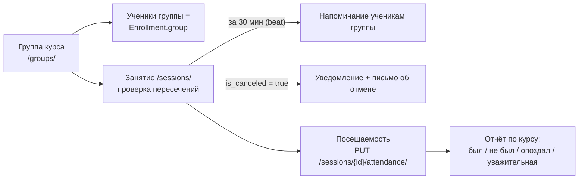

Расписание видят ученик (его группы), родитель (группы детей), преподаватели курсов и кураторы.

### 8.6. Приглашения

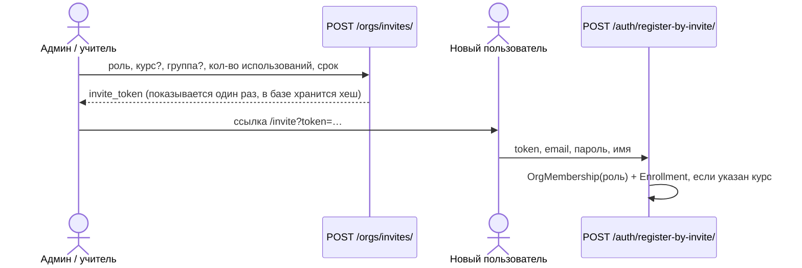

Учитель может приглашать только учеников и только на курс своей школы. Приглашения других ролей создаёт админ.

### 8.7. Родитель и ребёнок

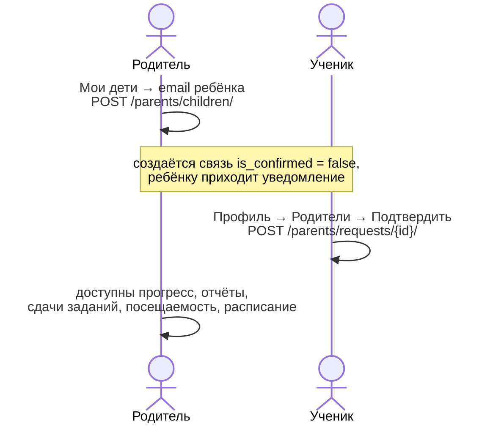

Пока ребёнок не подтвердил связь, у родителя нет доступа к его данным. Ребёнок может отозвать доступ в любой момент.

---

## 9. Уведомления и фоновые задачи

Все уведомления создаёт `NotificationService.notify()` ([`notifications/services.py`](../backend/apps/notifications/services.py)):

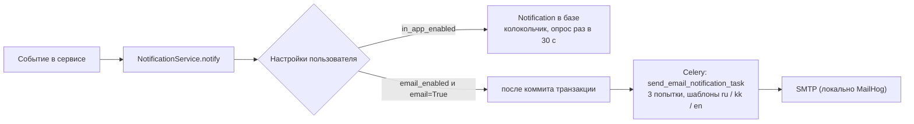

| Событие | Тип | Письмо |
|---|---|---|
| Новое задание | `assignment_new` | да |
| Скоро дедлайн (beat, раз в час) | `assignment_deadline` | да |
| Работа проверена | `assignment_graded` | да |
| Результат теста | `test_result` | нет |
| Скоро занятие (beat, каждые 5 мин) | `session_start` | нет |
| Занятие отменено | `system` | да |
| Ответ на комментарий | `comment_reply` | нет |
| Объявление | `announcement` | нет |
| Доступ к курсу открыт / возврат | `enrollment` / `payment` | да |
| Запрос родителя | `parent_link` | нет |

Расписание задач `beat` задаётся в `CELERY_BEAT_SCHEDULE` в [`config/settings/base.py`](../backend/config/settings/base.py).

---

## 10. Как устроен бэкенд

### Слои

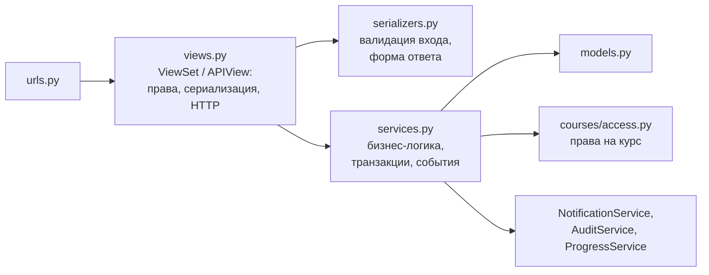

Правило простое: **логика живёт в `services.py`**, а view остаётся тонким. Поэтому одну и ту же операцию можно вызвать из API, из Celery-задачи или из сида.

### Базовые классы, на которых построены почти все эндпоинты

| Класс | Где | Для чего |
|---|---|---|
| `CourseScopedViewSet` | `common/viewsets.py` | объекты внутри курса (разделы, уроки, видео, тесты, задания, занятия). Чтение: курсы, которые пользователь видит. Изменение: только с `can_manage_course`. Наследник задаёт `course_path` и `course_from_data()` |
| `OrgScopedViewSet` | `common/org_viewsets.py` | объекты организации (темы, вопросы). Нужен `X-Org-ID`, роли задаются в `read_roles` / `write_roles` |
| `TenantJWTAuthentication` | `common/authentication.py` | проверка JWT + определение организации |
| `custom_exception_handler` | `common/exceptions.py` | все ошибки приходят в формате `{"error": {"code", "message", "details"}}` |
| `StandardPagination` | `common/pagination.py` | списки: `{total, total_pages, page, page_size, results}` |

### Как добавить новый эндпоинт

1. Модель в `apps/<app>/models.py`, затем `make migrations`.
2. Логику пишите в `services.py`, права берите из `courses/access.py`.
3. Создайте ViewSet: обычно наследник `CourseScopedViewSet` или `OrgScopedViewSet`. Добавьте `@extend_schema(tags=[...], summary=...)`, тогда эндпоинт появится в Swagger с описанием.
4. Зарегистрируйте маршрут в `apps/<app>/urls.py` (`SimpleRouter`).
5. Напишите тест в `tests/`: фикстуры `make_user`, `auth_client`, `course`, `enroll` лежат в `tests/conftest.py`.
6. Проверьте: `make test`, `make lint`, `python manage.py spectacular --validate`.

Swagger со всеми эндпоинтами: **http://localhost:8000/docs/** (корень `:8000/` ведёт туда же).

---

## 11. Как устроен фронтенд

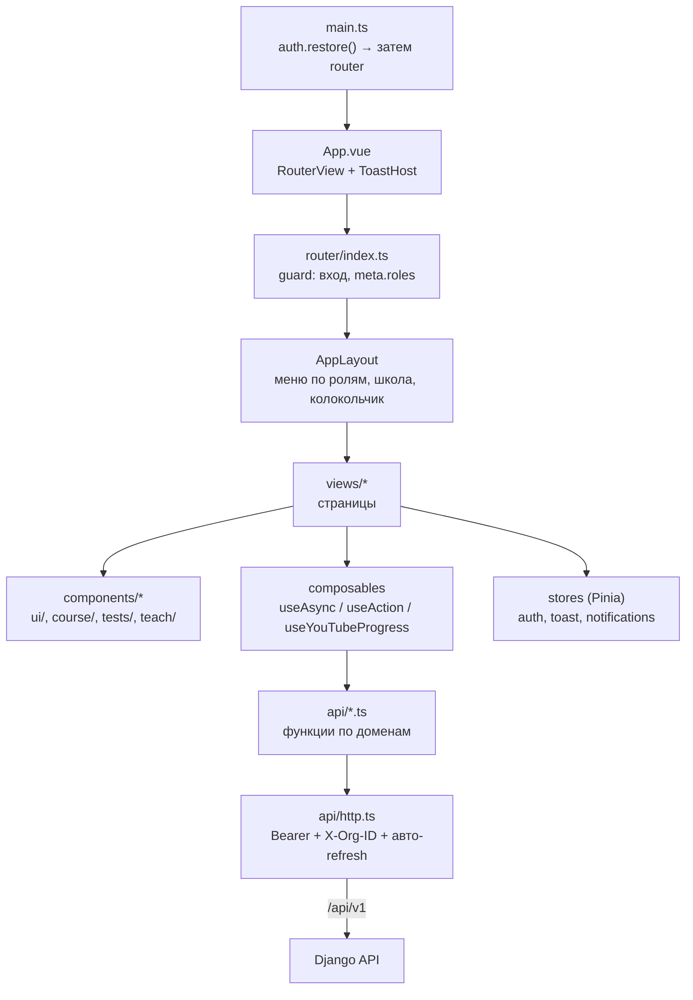

Страницы по ролям:

| Раздел | Страницы (`src/views`) |
|---|---|
| Вход | `auth/Login`, `Register`, `InviteRegister`, `ForgotPassword`, `ResetPassword`, `VerifyEmail` |
| Общие | `Home` (своя для каждой роли), `Courses` (каталог), `Schedule`, `Notifications`, `Announcements`, `Orders`, `Profile` |
| Ученик | `courses/MyCourses`, `courses/Course`, `courses/Lesson`, `tests/TestTake`, `tests/AttemptResult`, `assignments/*`, `progress/MyProgress`, `progress/CourseReport` |
| Родитель | `progress/Children` (+ отчёт по курсу с `?student=`) |
| Учитель | `teach/TeachCourses`, `teach/CourseEditor` (вкладки: программа, настройки, тесты, задания, группы, ученики), `teach/LessonEditor`, `teach/TestEditor`, `teach/QuestionBank`, `teach/Submissions` |
| Админ | `admin/AdminDashboard`, `admin/Members`, `admin/Invites`, `admin/Audit`, `admin/OrgSettings`, `Orders` (режим админа) |

Подробные правила для разработки фронтенда (в том числе с Claude Code) описаны в [`frontend/CLAUDE.md`](../frontend/CLAUDE.md). Стили намеренно простые: все цвета заданы CSS-переменными в [`src/assets/main.css`](../frontend/src/assets/main.css), и новый дизайн начинается с их замены.

---

## 12. Карта API

Все пути начинаются с `/api/v1/`. Полное описание с примерами есть в Swagger.

| Префикс | Что внутри |
|---|---|
| `auth/` | регистрация, вход, refresh, выход, сессии, 2FA, сброс пароля, подтверждение email, `users/me/` |
| `parents/` | `children/`, `requests/`: связь «родитель — ученик» |
| `orgs/` | `my/`, `current/`, `members/`, `invites/` |
| `courses/` | каталог, `my/`, CRUD, `{id}/enroll-student/`, `{id}/enrollments/` |
| `groups/`, `sessions/`, `attendance/` | группы, расписание, посещаемость |
| `sections/`, `lessons/`, `materials/`, `comments/` | содержимое курса; `lessons/{id}/complete/`, `materials/{id}/download/` |
| `videos/` | CRUD для учителя, `{id}/play/`, `{id}/progress/` |
| `topics/`, `questions/` | банк вопросов организации |
| `tests/` | CRUD, `{id}/questions/`, `{id}/stats/`, `{id}/attempts/`, `attempts/{id}/…` |
| `assignments/`, `submissions/` | задания, `submit/`, `grade/`, `download/` |
| `notifications/`, `announcements/` | уведомления, `read/`, `read-all/`, `unread-count/`, `preferences/` |
| `payments/` | `orders/` (+ `mark-paid/`, `refund/`, `cancel/`, `providers/`), `webhooks/stripe/` |
| `progress/` | `my/`, `courses/{id}/`, `courses/{id}/students/`, `students/{id}/`, `org/summary/` |
| `audit/` | `logs/` |

Вне `/api/v1/`: `/health/`, `/ready/` (проверка базы), `/admin/` (Django admin), `/docs/`, `/redoc/`, `/api/schema/`.

---

## 13. Безопасность

- **Пароли** хешируются Argon2id, минимальная длина 10 символов, есть проверка на распространённые пароли.
- **Вход:** 5 неудачных попыток с одного IP на один email блокируют вход на 15 минут. На публичные auth-эндпоинты стоит ограничение частоты (DRF throttle).
- **Токены:** access-токены живут коротко и умирают при смене пароля. Refresh хранится только как хеш, ротируется при каждом обновлении, а повторное использование старого токена отзывает все сессии.
- **2FA** через TOTP, секрет зашифрован, резервные коды одноразовые.
- **Изоляция организаций** проверяется на каждом запросе по членству. Чужие объекты отвечают 404.
- **Видео:** ID ролика YouTube не попадает в списки, плеер выдаётся только при наличии доступа (`youtube-nocookie.com`).
- **Тесты:** ответы не уходят клиенту до сдачи, таймер считается на сервере, события античита записываются в журнал.
- **Файлы:** проверяются размер (по умолчанию до 20 МБ) и расширение, имена случайные, скачивание только через API с проверкой прав.
- **Оплата:** у заказов есть идемпотентность, подпись вебхука Stripe проверяется.
- **Аудит:** входы, смены паролей и ролей, создание и удаление курсов, оплаты и возвраты пишутся в `AuditLog`.

---

## 14. Запуск, демо-данные, тесты

```bash
cd edu_platform
make up      # всё в Docker: db, redis, backend, worker, beat, frontend, mailhog
make seed    # демо-данные и список аккаунтов
```

Открыть: фронтенд http://localhost:5173 · Swagger http://localhost:8000/docs/ · письма http://localhost:8025

На странице входа есть кнопки быстрого входа под каждую роль. Таблица демо-аккаунтов есть в [`README.md`](../README.md). Что подготовлено в демо-данных:
- **Ученик 1** записан на «Алгебру» (группа 10 «А»): у него есть занятия на ближайшие дни, задания (одно сдано и ждёт проверки) и два теста, один с развёрнутым ответом.
- **Ученик 2** записан на кружок. Его заказ на «ЕНТ по физике» ждёт подтверждения админом.
- **Родитель** привязан к ученику 1, связь подтверждена.
- **Пользователь «Две школы»** — ученик в ФизМат и учитель в «Школе №2»; на нём удобно проверять переключатель школ.
- **Админ Школы №2** видит только свою школу.

| Команда | Что делает |
|---|---|
| `make test` | pytest в контейнере (настройки `config.settings.test`: locmem-кэш, Celery синхронно) |
| `make lint` | ruff |
| `make migrations` / `make migrate` | создать / применить миграции |
| `make logs` | логи всех сервисов |
| `docker compose exec frontend npm run build` | проверка типов и сборка фронтенда |

CI ([`.github/workflows/ci.yml`](../../.github/workflows/ci.yml)) запускает на каждый push две задачи: **backend** (ruff, проверка, что миграции актуальны, pytest на PostgreSQL) и **frontend** (`vue-tsc` + сборка).

---

## 15. Что пока не сделано

- **Kaspi Pay**: адаптер-заглушка. Для подключения нужны договор и API мерчанта.
- **Хранилище файлов**: локальный диск. Для продакшена нужно подключить S3/MinIO через `django-storages`.
- **Интерфейс на казахском и английском**: шаблоны писем уже на трёх языках, а сам интерфейс только на русском.
- **Видео загружается только с YouTube**: длительность вводится вручную (автоматически подтянуть её можно через YouTube Data API, `YOUTUBE_API_KEY`).
- **Продакшен-конфигурация**: есть `config/settings/prod.py` и стадии `prod` в Dockerfile, но отдельного `docker-compose.prod.yml` и настройки HTTPS/доменов пока нет.
- **Мониторинг**: логирование и Sentry не настроены.
