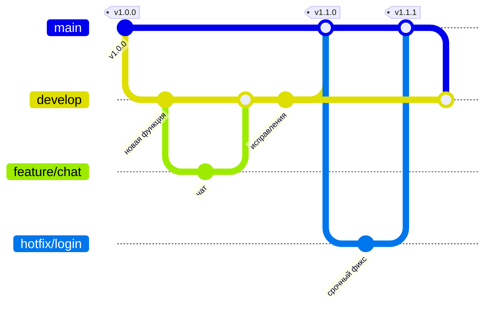

# Ветки и релизы

В репозитории две постоянные ветки:

| Ветка | Назначение | Кто пишет |
|---|---|---|
| **`main`** | **Стабильная версия, которая работает на сервере.** Пользуются ей все. Обновляется только релизом. | Только через Pull Request из `develop` или `hotfix/*` |
| **`develop`** | **Разработка.** Все новые функции, правки и эксперименты сначала попадают сюда. | Коммиты напрямую или PR из `feature/*` |



## Каждый день: работа в `develop`

```bash
git checkout develop
git pull
# ...правки...
git add -A
git commit -m "Описание изменения"
git push
```

Если задача большая, лучше сделать для неё отдельную ветку и потом влить её в `develop`:

```bash
git checkout develop
git pull
git checkout -b feature/название
# ...коммиты...
git push -u origin feature/название
```

На GitHub откройте Pull Request **`feature/название` → `develop`**. После проверки CI нажмите Merge.

## Релиз: обновить сервер

1. Убедитесь, что в `develop` всё работает: CI зелёный, локально `make test` и `npm run build` проходят, нужные сценарии проверены в браузере.
2. На GitHub откройте Pull Request **`develop` → `main`**.
3. Дождитесь зелёного CI и нажмите Merge.
4. Поставьте тег версии:
   ```bash
   git checkout main
   git pull
   git tag -a v1.1.0 -m "Что вошло в релиз"
   git push origin v1.1.0
   ```
5. На сервере обновитесь до `main`, примените миграции и перезапустите сервисы — это делает одна команда
   `bash ~/apps/backend-bagdar.academy/edu_platform/deploy/deploy.sh` (см. [deploy/README.md](../deploy/README.md)).

Номер версии строится по схеме `vБОЛЬШАЯ.СРЕДНЯЯ.МАЛАЯ`:
- **малая** (`v1.1.1`) — исправления ошибок;
- **средняя** (`v1.2.0`) — новые функции;
- **большая** (`v2.0.0`) — несовместимые изменения: API, данные, процесс работы.

## Срочное исправление на сервере (hotfix)

Если на сервере ошибка, а `develop` ещё не готов к релизу:

```bash
git checkout main
git pull
git checkout -b hotfix/кратко-о-проблеме
# ...исправление + тест...
git push -u origin hotfix/кратко-о-проблеме
```

1. PR **`hotfix/…` → `main`**, Merge, тег `v1.1.1`.
2. Верните исправление в разработку: PR **`main` → `develop`** (или `git checkout develop && git merge main && git push`).

## Защита веток (настраивается один раз на GitHub)

**Settings → Branches → Add branch ruleset** для `main`:
- ✅ Require a pull request before merging (прямой `git push` в `main` будет запрещён);
- ✅ Require status checks to pass → выбрать `backend`, `frontend`, `release-source`;
- ✅ Block force pushes.

Для `develop` достаточно включить **Block force pushes**.

Сам CI ([`.github/workflows/ci.yml`](../../.github/workflows/ci.yml)) запускается на push и Pull Request в обе ветки. Задача `release-source` не даст влить в `main` ничего, кроме `develop` и `hotfix/*`.

## Что где лежит прямо сейчас

| Ветка / тег | Что это |
|---|---|
| `main` + тег `v1.0.0` | первая стабильная версия: бэкенд, фронтенд, Docker, демо-данные |
| `develop` | продолжение разработки от `v1.0.0` |
| `restructure-backend-frontend`, `feature/backend-complete`, `feature/frontend` | уже влитые ветки предыдущих этапов; их можно удалить на GitHub (Branches → 🗑), история сохранится в `main` |
